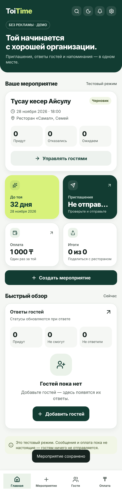
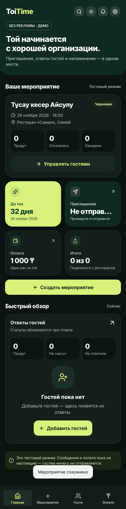

# ToiTime

Мобильное приложение для организации тоев, свадеб и дней рождения в Казахстане. Организатор создаёт мероприятие, выбирает гостей из контактов, оплачивает 1 000 ₸, и гости получают приглашение в WhatsApp со ссылкой «Приду» / «Не смогу прийти». Устанавливать приложение гостю не нужно.

> **Статус: MVP в тестовом режиме.** WhatsApp и оплата работают через эмуляторы. Реальные сообщения не отправляются, деньги не списываются, пока интеграции не подключены и не проверены (см. «Что нужно для запуска»).



## Состав

| Папка | Что внутри |
|---|---|
| `mobile/` | Приложение на Expo (React Native) для iOS и Android, Expo Router |
| `server/` | Node.js + Express, PostgreSQL, фоновый воркер рассылки |
| `server/src/views/pages.js` | Веб-страница гостя по защищённой ссылке, тестовая страница оплаты |
| `server/migrations/` | Схема базы данных |
| `server/test/` | Автотесты по условиям приёмки |
| `docs/screenshots/` | Скриншоты сквозного прогона |

## Как это работает

1. **Согласие.** При первом запуске организатор отмечает согласие на обработку персональных данных. Без него сервер не выдаёт сессию.
2. **Мероприятие.** Название, дата, время, ресторан/адрес, имя и телефон хозяина, язык приглашения (русский или казахский), текст приглашения, фото или видео-приглашение, срок первого напоминания (за 10 или 7 дней). Один экран.
3. **Гости.** Из контактов телефона (только после системного разрешения; читаются только имя и телефон, на сервер уходят лишь отмеченные) или вручную. Номера приводятся к виду `+7XXXXXXXXXX`, дубли отсекаются. Гостя можно удалить, снять с рассылки или вручную поставить ему ответ (например, он ответил по телефону — тогда напоминания ему не уйдут).
4. **Оплата 1 000 ₸.** Приложение создаёт платёж и открывает страницу провайдера. Статус «оплачено» ставит только сервер, получив подписанный вебхук провайдера с правильной суммой. Кнопка в интерфейсе ничего не подтверждает.
5. **Рассылка.** Приглашения уходят только выбранным гостям, после подтверждения организатором согласия гостей на сообщения. Их ставят в очередь. Уникальный ключ `(гость, тип сообщения)` в базе не даёт отправить одно и то же дважды, даже при повторном нажатии.
6. **Ответ гостя.** Ссылка вида `/r/<токен>`, где токен — id гостя + HMAC-подпись. Подобрать или подделать нельзя, другие гости и данные не видны. Ответ сразу меняет статистику и создаёт уведомление организатору (лента в приложении + push).
7. **Напоминания** за 10/7 дней, за 3 дня и за 1 день до тоя, **в 9:00 по времени Астаны**, тем, кто ответил «Приду», и тем, кто ещё не ответил (ответившим «Не смогу» и отказавшимся от сообщений не приходят). Ответившим «Приду» уходит текст «ждём вас», не ответившим — просьба ответить. Напоминания можно выключить для мероприятия. Статус гостя перепроверяется прямо перед отправкой. Если сервер простаивал и пропустил несколько сроков, уходит только последнее напоминание.
8. **Отказ от сообщений.** Кнопка на странице гостя или слово «СТОП» в ответ в WhatsApp. Действует на все мероприятия.
9. **Отзыв согласия.** В настройках приложения: аккаунт, мероприятия, гости и сообщения удаляются с сервера.

### Надёжность WhatsApp

- Отправка через официальный WhatsApp Cloud API шаблонами на русском и казахском (тексты в `server/src/integrations/whatsapp-templates.js`): `toytime_invite`, `toytime_invite_image` и `toytime_invite_video` (с фото или видео в шапке), `toytime_reminder` (не ответившим) и `toytime_reminder_yes` (ответившим «Приду»).
- Фото или видео-приглашение хранится в базе и отдаётся по подписанной ссылке `/media/<токен>`: её забирает WhatsApp, её же показывает страница гостя. Ограничения WhatsApp: фото JPEG/PNG до 5 МБ, видео MP4 до 16 МБ. Файл уходит с каждым приглашением, в том числе гостям, добавленным после рассылки.
- Вебхук `/webhooks/whatsapp`: проверка подписи `X-Hub-Signature-256`, верификация `hub.challenge`, статусы `sent → delivered → read` (не понижаются при приходе не по порядку), `failed` с уведомлением организатора. Повторные вебхуки отсеиваются.
- Повторные попытки с растущей паузой (30 с, 60 с, …, до 5 попыток) **только** когда точно известно, что сообщение не ушло (429, 5xx, нет соединения).
- Если исход неизвестен (таймаут, сервер упал во время отправки), сообщение получает статус `unknown` и **не** повторяется автоматически: лучше одна пропущенная отправка, чем дубль гостю.

### Тестовый режим и журнал ошибок

Все внешние интеграции (WhatsApp, оплата, push) по умолчанию в тестовом режиме. Каждое событие и ошибка пишутся в таблицу `integration_logs` с пометкой `test_mode`.

- `GET /admin/logs?token=ADMIN_TOKEN` — журнал (параметр `level=error` — только ошибки).
- `GET /test/whatsapp?token=ADMIN_TOKEN` — что «отправил» бы WhatsApp, с текстами и ссылками.
- `/test/pay/<id>` — тестовая страница оплаты с кнопками «оплата прошла» / «отклонена». Она шлёт серверу такой же подписанный вебхук, как настоящий провайдер.
- Номера для проверки ошибок в эмуляторе: на `…0001` временная ошибка, на `…0002` постоянная, на `…0003` неизвестный исход.

## Быстрый тест на своём компьютере (без установки базы)

Нужен только Node.js 22.

```bash
cd server && npm install && npm run demo      # сервер + встроенная база PGlite
cd mobile && npm install && npx expo start --web   # приложение в браузере
```

Приложение откроется на http://localhost:8081, сервер на http://localhost:3000. Тестовые сообщения WhatsApp видны на http://localhost:3000/test/whatsapp?token=dev-admin, оттуда же можно открыть ссылку гостя.

Чтобы открыть приложение на телефоне через Expo Go (телефон в той же Wi-Fi сети), запустите сервер с `PUBLIC_URL=http://<IP-компьютера>:3000`, а приложение командой `EXPO_PUBLIC_API_URL=http://<IP-компьютера>:3000 npx expo start` и отсканируйте QR-код.

## Показ по ссылке (Render)

В корне лежит `render.yaml`: он создаёт на Render сервер и базу PostgreSQL на бесплатном тарифе. Сервер отдаёт и API, и веб-версию приложения, и страницы гостей по одной ссылке.

1. Зарегистрируйтесь на render.com через GitHub.
2. New → Blueprint → выберите репозиторий `toytime` → Apply.
3. Через 5–10 минут сервис будет доступен по адресу вида `https://toytime-xxxx.onrender.com`.

Тестовый ящик WhatsApp: `https://<адрес>/test/whatsapp?token=<ADMIN_TOKEN>`, где токен находится в Render → toytime → Environment. На бесплатном тарифе сервер засыпает после 15 минут простоя, и первое открытие занимает около минуты. Бесплатная база работает 30 дней.

## Демо на телефоне

**Android (APK, бесплатно).** Нужен аккаунт expo.dev. В папке `mobile`:

```bash
npx eas-cli@latest login
npx eas-cli@latest build -p android --profile preview
```

На вопросы о создании проекта и ключа подписи ответьте «Y». Через 10–30 минут EAS выдаст ссылку и QR-код для скачивания APK. Приложение работает с сервером `https://toytime.onrender.com` (адрес задан в `eas.json`).

**iPhone.** Бесплатно поставить приложение файлом на iPhone нельзя: Apple требует аккаунт разработчика ($99 в год) для TestFlight или установки по ссылке. Для демо откройте сайт в Safari → «Поделиться» → «На экран Домой»: появится иконка ToiTime, и приложение откроется на весь экран без адресной строки.

## Запуск локально

Нужны Node.js 22 и PostgreSQL 16.

```bash
# сервер
cd server
cp .env.example .env        # и заполнить секреты
createdb toytime
npm install
npm run migrate
npm start                   # http://localhost:3000

# тесты (нужна база toytime_test)
createdb toytime_test
npm test

# приложение
cd ../mobile
npm install
EXPO_PUBLIC_API_URL=http://<IP-компьютера>:3000 npx expo start
```

Приложение использует нативные модули (контакты, push), поэтому для телефона нужна development build: `npx expo run:ios` / `npx expo run:android` или `npx eas-cli build --profile development`. Для быстрого просмотра есть веб-версия: `npx expo start --web` (контакты в браузере недоступны, только ручной ввод).

## Что проверено

- 19 автотестов сервера по условиям приёмки (`server/test/acceptance.test.js`): создание мероприятия, добавление/удаление гостей, оплата только по подписанному вебхуку с верной суммой, отсутствие дублей, расписание напоминаний (9:00 по Астане, «Приду» и не ответившие), фото/видео-приглашение и телефон хозяина, приглашение на казахском, отказ от сообщений, повторы и неизвестный исход, вебхуки, изоляция организаторов, отзыв согласия, журнал ошибок.
- Типы приложения (`tsc --noEmit`) и сборка бандлов для Android и web.
- Сквозной прогон в браузере (веб-версия приложения + сервер): от приветствия до отправки приглашений, ответ двух гостей по ссылкам, автообновление статистики и уведомления. Скриншоты в `docs/screenshots/`.
- **Не проверено:** запуск на реальных iPhone/Android, выбор из настоящих контактов, push-уведомления, реальный WhatsApp Cloud API и реальная оплата.

## Что нужно для запуска

1. **WhatsApp Business Platform:** аккаунт Meta Business, верификация компании, номер, приложение в Meta for Developers. Подать на одобрение шаблоны из `whatsapp-templates.js` (категория Utility, языки ru и kk, кнопка-ссылка `https://<домен>/r/{{1}}`). Затем указать `WHATSAPP_*` и `WHATSAPP_TEST_MODE=false`, настроить вебхук на `https://<домен>/webhooks/whatsapp`. Код клиента Cloud API написан, но на живом аккаунте ещё не проверен.
2. **Платёжный провайдер** (Kaspi Pay, CloudPayments, ioka, Freedom Pay и др.) и договор на ИП/ТОО. Нужно написать адаптер рядом с эмулятором в `server/src/integrations/payments.js` под API выбранного провайдера: создание платежа и проверка его вебхука.
3. **Правила магазинов приложений.** Apple и Google могут потребовать оплату через встроенные покупки. Схему оплаты лучше согласовать до публикации. В макете была кнопка Google Play / Apple Pay: в MVP её нет, вместо неё страница провайдера.
4. **Аккаунты разработчика** Apple ($99/год) и Google Play ($25), проект в EAS (нужен и для push: `extra.eas.projectId` в `app.json`).
5. **Хостинг** с HTTPS для сервера и PostgreSQL, домен для ссылок гостей.
6. **Политика конфиденциальности:** черновик на `/privacy`, его должен проверить юрист на соответствие закону РК о персональных данных.

## Экраны по HTML-макету заказчика

Приложение повторяет HTML-макет заказчика (`toytime_test.html`): шапка Toi**Time**, четыре вкладки — **Главная**, **Мероприятие**, **Гости**, **Оплата** — и экран **«Приглашение гостям»** (кому отправить, напоминания, согласие, предпросмотр сообщения, «Что увидит гость»). В отличие от макета всё работает на настоящем сервере, а не на демо-данных.

Дополнительно к макету: уведомления и настройки (отзыв согласия) — кнопками в шапке; гости из контактов; отсчёт дней до тоя; «Поделиться итогами» (кто придёт — для ресторана и родных); переключение между несколькими мероприятиями; открытие настоящей страницы гостя из приложения.

### Интерфейс 2026

- Карточная раскладка Bento на главной: отсчёт до тоя, приглашения, оплата, итоги.
- Светлая и тёмная темы (Настройки → Оформление, или иконка солнца/луны в шапке; по умолчанию как в системе).
- Иконки Lucide, шрифт Inter, скругления 12–24 px, мягкие тени, скелетоны при загрузке, микро-анимации нажатий и появления.
- Поиск по гостям, мероприятиям и действиям: Ctrl+K / ⌘K в веб-версии, иконка лупы в шапке на телефоне.
- Пустые экраны с кнопкой следующего шага; после создания мероприятия — кнопки «На главную», «Добавить гостей», «Изменить».
- Контраст текста не ниже 7:1 (WCAG AAA) в обеих темах.



### Языки

Приложение на русском и казахском: переключатель на первом экране и в Настройках → «Язык приложения». Язык приглашения выбирается отдельно для каждого мероприятия: на нём уходит сообщение в WhatsApp и открывается страница гостя. Казахский перевод (`mobile/src/lib/i18n.kk.ts`, шаблоны и страница гостя на сервере) перед публикацией должен проверить носитель языка.

ТЗ имеет приоритет над макетами: цена 1 000 ₸. Напоминания по доп. ТЗ от 29.10.2026: за 10/7, 3 и 1 день в 9:00 по Астане, ответившим «Приду» и не ответившим.
